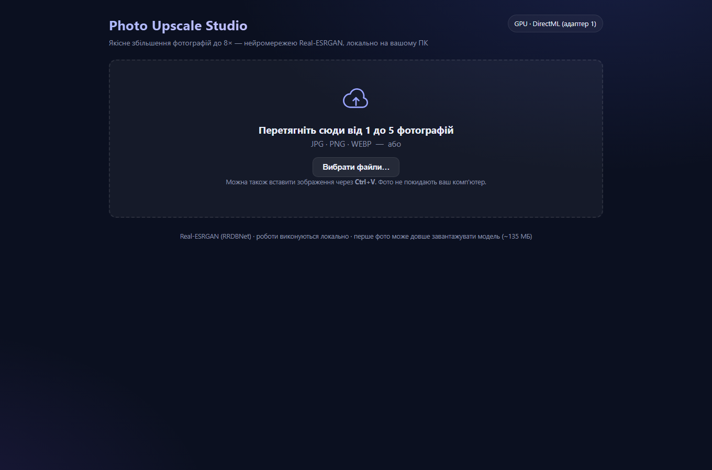

# Photo Upscale Studio

**Локальна програма для якісного збільшення фотографій до 8×** — нейромережева
супререшітка Real-ESRGAN. Інтерфейс відкривається в браузері, але вся обробка
відбувається на вашому комп'ютері: фото не надсилаються в інтернет.



## Можливості

- 🖼️ Завантаження **1–5 фото за раз**: перетягуванням, кнопкою або `Ctrl+V`;
  зайві понад 5 — не приймаються з чітким повідомленням.
- ✂️ Мініатюри з розмірами та видаленням будь-якого фото перед обробкою.
- 🔍 Коефіцієнт збільшення **1×–8×** (слайдер; за замовчуванням 8×).
- 📊 Живий прогрес: скільки фото готово / в черзі, етапи та оцінка часу.
- 🆚 Порівняння «до / після» — просто протягніть повзунок по фото.
- ⬇️ Завантаження кожного результату окремо або **всіх одним ZIP-архівом**.
- 🧯 Помилки обробляються по кожному фото: якщо одне «не пішло» — інші
  обробляться, а ви побачите зрозуміле пояснення.

## Швидкий старт (5 хвилин)

1. **Встановіть Python 3.10 або новіший.**
   Windows: [python.org/downloads](https://www.python.org/downloads/)
   (під час інсталяції позначте «Add Python to PATH»).
2. Відкрийте термінал у папці проєкту та виконайте:

   **Windows (PowerShell):**
   ```powershell
   python -m venv .venv
   .venv\Scripts\pip install -r requirements.txt
   .venv\Scripts\python run.py
   ```

   **Linux / macOS:**
   ```bash
   python3 -m venv .venv
   .venv/bin/pip install -r requirements.txt
   .venv/bin/python run.py
   ```

3. Браузер відкриється самостійно на `http://127.0.0.1:8560`
   (якщо ні — відкрийте цю адресу вручну).
4. **На перше фото** програма один раз завантажить ваги моделей Real-ESRGAN
   з Hugging Face (які потрібні саме вашому пристрою: ~96 МБ на GPU або
   ~128 МБ на CPU) у папку `models/` і звірить SHA-256. Далі все працює
   офлайн.

Зупинка програми: `Ctrl+C` у вікні терміналу. Перевірка всієї логіки однією
командою (при запущеній програмі): `python scripts/selftest.py`.

## Прискорення на GPU — на Windows вже увімкнено

Рушій виконує модель через **ONNX Runtime**. На Windows залежності ставлять
`onnxruntime-directml`, тому апаратне прискорення на відеокартах
**NVIDIA · AMD · Intel** (через DirectX 12 / DirectML) працює **одразу після
`pip install`**: програма сама обере GPU та покаже в шапці
«GPU · DirectML (адаптер N)». Якщо відеокарт кілька — автоматично
бенчмарком обирається найшвидший адаптер.

- Компоненти DirectML підписані Microsoft, тож рушій працює навіть зі
  **увімкненим Smart App Control** (на відміну від збірок torch з
  неподписаними DLL).
- Немає GPU або старий драйвер? Рушій сам і прозоро переходить на CPU
  (повільніше, але стабільно).
- Linux / macOS: ставиться звичайний `onnxruntime` (CPU). Власникам
  NVIDIA на Linux можна опціонально поставити `onnxruntime-gpu` (потрібен
  CUDA 12+) — рушій знайде `CUDAExecutionProvider` автоматично.

## Формати та обмеження

| Параметр | Значення |
|---|---|
| Вхідні формати | JPG · PNG · WEBP (EXIF-поворот враховується, прозорість зберігається) |
| Фото за раз | до 5 |
| Розмір файлу | до 100 МБ |
| Результат | ≤ 256 Мп (~16 000×16 000); інтерфейс підказує зменшити масштаб при перевищенні (конфіг: змінна `UPSCALE_MAX_OUTPUT_MP`) |
| Формати результату | JPG (q95) · PNG · WEBP (q95) |
| Порт | `http://127.0.0.1:8560` (якщо зайнятий — програма візьме сусідній; власний: `python run.py --port 9000`) |

## Продуктивність

Виміряно на тестовій машині (RTX 4050 Laptop 6 ГБ · DirectML fp16 /
CPU 8 потоків) — не рахуючи одноразової збірки сесій (~10–20 с на
першому фото):

| Пристрій | Час одного тайла* |
|---|---|
| GPU · DirectML (RTX 4050) | ~2,9 с (тайл 512 px) |
| CPU · 8 потоків | ~35–41 с (тайл 384 px) |

\* тайл — одиниця обчислень: на кожну стадію масштабування число
тайлів ≈ `⌈ширина/464⌉ × ⌈висота/464⌉` (GPU). Орієнтовний час фото 800×600:

| Масштаб | GPU ≈ | CPU ≈ |
|---|---|---|
| 2× | 12 с | 4 хв |
| 4× | 12 с | 4 хв |
| 8× (дві стадії) | 25 с | 8 хв |

Час зростає приблизно пропорційно **площі фото**. Фото з камери (12 Мп) при
8× дасть ~768 Мп — понад ліміт 256 Мп, тож для таких фото обирайте 2×–4×.

Вимоги до заліза: Python 3.10+, ОЗУ мінімум 8 ГБ (комфортно 16 ГБ), диск
~450 МБ (залежності ~280 МБ + ваги моделей до 160 МБ). GPU — необов'язковий,
але краще для 4×–8× на великих фото.

## Як це працює (коротко)

- **Real-ESRGAN (RRDBNet) у форматі ONNX** — генеративна мережа супререшітки:
  замість бікубічної «каші» відновлює текстури та різкість країв.
  Використано конверсії офіційних вагів `RealESRGAN_x4plus` (4×) і
  `RealESRGAN_x2plus` (2×) (BSD-3-Clause, [xinntao/Real-ESRGAN](https://github.com/xinntao/Real-ESRGAN));
  хеші SHA-256 файлів зафіксовані в `app/config.py` і перевіряються при
  завантаженні. Масштаб 8× = ланцюжок 4× → 2×; проміжні коефіцієнти
  (3×, 5×, 6×, 7×) досягаються фінальним Lanczos-ресайзом.
- **Тайлова інференс з контекстом.** Будь-яке велике фото ділиться на тайли
  *фіксованої* форми — вхід моделі завжди строго 512² px (GPU) або 384² px
  (CPU): одна компіляція шейдерів і передбачуване споживання пам'яті,
  незалежно від розміру фото. В оброблений результат записується лише
  «ядро» тайла (тайл мінус 24 px контексту з кожного боку), а сусідні ядра
  стуляються без зазорів — швів не видно. Контекст біля країв фото, якого
  бракує, доповнюється копіюванням крайніх рядків/стовпців (`edge`).
  Прогрес рахується за тайлами.
- **FastAPI + ванільний JS** — без білд-кроку та без CDN: інтерфейс
  працює повністю локально; імовірна помилка одного фото не впливає на
  інші у черзі.

## Структура проєкту

```
photo-upscale-studio/
├── run.py                        # точка входу (python run.py)
├── requirements.txt              # залежності (+ onnxruntime-directml на Windows)
├── .gitignore / LICENSE / README.md
├── app/
│   ├── main.py                   # HTTP API (FastAPI): сесії, черга, ZIP
│   ├── engine.py                 # рушій: ONNX-моделі, тайлова інференс
│   ├── jobs.py                   # фонові завдання обробки
│   └── config.py                 # ліміти, порти, URL + SHA-256 ваги моделей
├── static/                       # інтерфейс (index.html, app.js, style.css)
├── scripts/
│   ├── selftest.py               # інтеграційна самоперевірка API (запущений сервер)
│   ├── probe_models.py           # діагностика провайдера, швидкості та якості
│   └── test_tiled_inference.py   # юніт-тест мапінгу тайлів (без сервера)
├── docs/screenshot-main.png      # скріншот інтерфейсу
├── models/                       # ваги моделей (авто-завантаження; не в git)
└── data/                         # фото й результати користувача (не в git)
```

## Публікація на GitHub

1. На github.com створіть **порожній** репозиторій (без README).
2. У папці проєкту:

```bash
git init
git add .
git commit -m "Initial commit: Photo Upscale Studio"
git branch -M main
git remote add origin https://github.com/ВАШ_НІК/photo-upscale-studio.git
git push -u origin main
```

(якщо перший коміт вже зроблено — виконайте лише три останні команди).

Пропозиції для сторінки репозиторію:

- **Назва:** `photo-upscale-studio`
- **Опис (About):** Local AI photo upscaler — Real-ESRGAN on ONNX Runtime (DirectML/CPU): upscale JPG/PNG/WEBP up to 8× in your browser, fully offline · Локальний апскейл фотографій нейромережею до 8×
- **Topics:** `image-upscaling`, `realesrgan`, `super-resolution`, `onnx`, `onnxruntime`, `directml`, `fastapi`, `image-processing`, `ai`, `photo-tools`, `python`

## Ліцензія

MIT — дивіться [LICENSE](LICENSE). Ваги моделей Real-ESRGAN поширюються
їх авторами (проєкт [xinntao/Real-ESRGAN](https://github.com/xinntao/Real-ESRGAN)).
